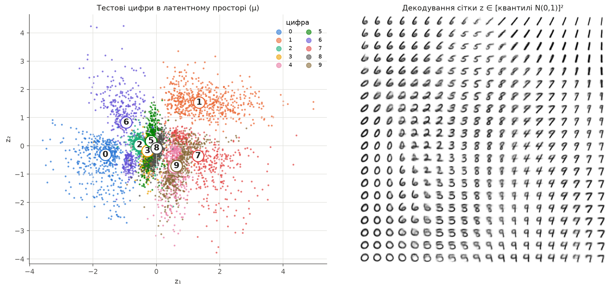

# Генерація рукописних цифр за допомогою AE та VAE

Навчальний проєкт (тема 14) з курсу «Нейронні мережі».
Авторка: Плотнікова Владислава, група ТК-41, КНУ імені Тараса Шевченка.

## Суть роботи

Мета — навчити модель створювати **нові** зображення рукописних цифр, схожі на MNIST, але не скопійовані з нього.
Для цього порівнюються дві моделі:

- **Автоенкодер (AE)** стискає зображення 28×28 у короткий код z і відновлює його назад. Він добре відновлює картинки,
  але його латентний простір нерегулярний, тому з випадкового z він генерує погано.
- **Варіаційний автоенкодер (VAE)** кодує зображення не в точку, а в розподіл. KL-доданок у функції втрат стягує всі
  коди до N(0, I). Через це латентний простір стає неперервним, і генерація зводиться до простого кроку:
  z ∼ N(0, I) → декодер → нова цифра.

Також досліджено **β-VAE** (вага KL-доданку) та **Conditional VAE**, який генерує задану цифру.

## Що досліджується

| Експеримент | Що змінюється | Питання |
|---|---|---|
| E1 | AE / VAE | Чи потрібен KL-доданок для генерації? |
| E2 | розмір латентного простору d = 2…64 | Скільки вимірів потрібно моделі? Чи виникає posterior collapse? |
| E3 | β = 0.1…8 | Як виглядає компроміс між відновленням і якістю генерації? |
| E4 | MLP / згорткова архітектура | Чи дають згортки перевагу? |
| E5 | частка навчальних даних 2…100% | Скільки даних потрібно? Коли починається перенавчання? |
| E6 | Conditional VAE, d = 2, 8, 16 | Чи вміє модель генерувати задану цифру? |

Кожна конфігурація навчалася з 3 сідами (63 запуски). Модель обиралася за валідацією, а метрики рахувалися на тестовій вибірці.

**Метрики:** від'ємний ELBO (правдоподібність), помилка відновлення, кількість активних латентних вимірів,
а також метрики якості генерації. Останні рахуються окремим CNN-класифікатором (99.3% точності): FID на його ознаках,
частка «неоднозначних» генерацій, рівномірність класів і точність умовної генерації.

## Основні результати

- VAE генерує на порядок краще за AE (FID 277 проти 1943), хоча відновлює гірше (BCE 74.9 проти 63.1 нат).
- Модель реально використовує лише ~14–18 латентних вимірів. При більшому d зайві виміри «вимикаються» (posterior collapse).
- Найкраща правдоподібність досягається при β = 1, а найкраща генерація при β ≈ 2. Правдоподібність і якість зразків — різні цілі.
- Згортки покращують відновлення, але не якість генерації.
- 25% даних дають результат у межах 3.5% від повного. При ≤ 10% даних модель перенавчається.
- Conditional VAE покращує FID у ~5 разів і генерує задану цифру в 96.8% випадків.



## Структура репозиторію

```
configs/     гіперпараметри: базовий конфіг і 6 серій експериментів
src/         код: дані, моделі, навчання, метрики, візуалізації
scripts/     запуск з терміналу
notebooks/   01 дані · 02 перевірки · 03 експерименти · 04 результати
runs/        логи, криві навчання й метрики кожного запуску
results/     таблиці та графіки
report/      короткий технічний звіт
```

Детальний опис методики, результатів і обмежень — у [звіті](report/report.md).
